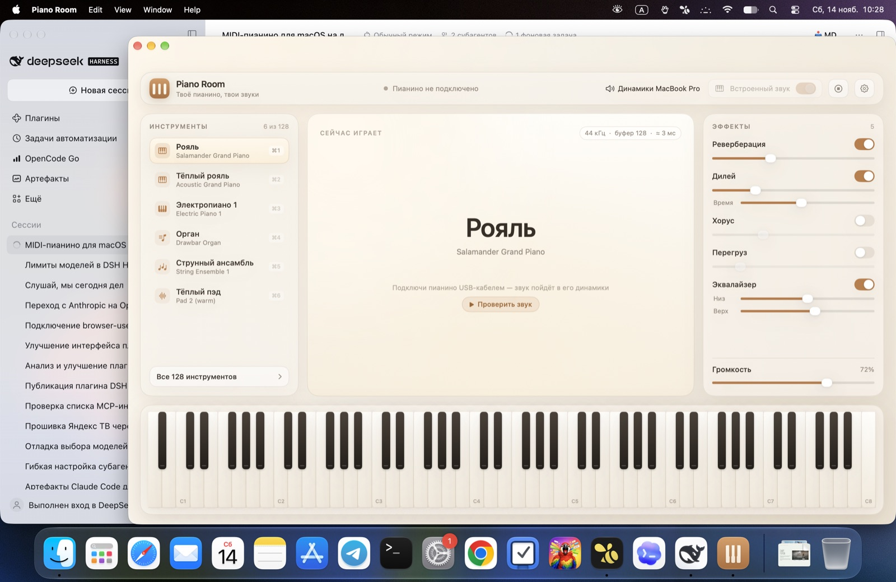

# Piano Room

Нативное приложение для macOS, которое превращает цифровое пианино в полноценный инструмент:
принимает MIDI с клавиатуры, играет качественным роялем или любым из 128 инструментов General MIDI,
добавляет эффекты и возвращает звук в динамики пианино по USB.

Сделано для пианино **Grace CP-250** (внутри плата Dream 5704PIA-DK), но работает с любой MIDI-клавиатурой.

Проект: [github.com/ungurenko/piano-room](https://github.com/ungurenko/piano-room) · лицензия MIT



---

## Первый запуск с пианино

1. Подключи USB-кабель к маку и включи пианино.
2. В шапке должно появиться «Grace CP-250 подключено», а в кнопке вывода — «5704PIA-DK».
3. Нажми клавишу: из динамиков пианино играет рояль Piano Room, а не его родной звук.
4. Тумблер «Встроенный звук» в шапке возвращает и глушит родной звук пианино.
5. `⌘ 3` или клик по инструменту слева — звук меняется (например, на электропиано).
6. Включи хорус и перегруз справа — эффект должен быть слышен.
7. Нажми кнопку тембра на панели пианино — приложение переключится на этот инструмент.
8. Закрой Piano Room (`⌘ Q`) — пианино вернёт свой звук.

Фишка, которой нет у обычных приложений: звук идёт обратно в динамики пианино
по его же USB-аудио, поэтому играть можно без колонок и лишних проводов.

---

## Что умеет

- 🎹 **Рояль Salamander Grand Piano** — 48 кГц, 24 бита, запись Yamaha C5. Основной инструмент.
- 🎼 **128 инструментов General MIDI** — электропиано, орган, струнные, пэды, духовые и остальное.
- ✨ **Пять эффектов**: реверберация, дилей, хорус, перегруз, эквалайзер. У каждого свой ползунок и тумблер.
- 🔊 **Выбор вывода**: динамики пианино (через его USB-аудио) или наушники/колонки мака.
- 🎛 **Глушение встроенного звука пианино** кнопкой: пианино работает только как клавиатура.
- 🎹 **Экранная клавиатура** на 88 клавиш с подсветкой нажатий. Клик мышкой играет ноту, а громкость зависит от того, где щёлкнуть: ниже — громче, как на настоящем пианино.
- 🔌 **Горячее подключение**: подключил пианино — приложение само его нашло.
- 💾 **Помнит настройки**: инструмент, эффекты, громкость, устройства.

---

## Установка

### Готовое приложение

На этом маке приложение уже собрано и лежит в **«Программы» → Piano Room**.

### Собрать из исходников

Нужны macOS 15+, Xcode 27 и XcodeGen.

```bash
brew install xcodegen
git clone https://github.com/ungurenko/piano-room.git
cd piano-room
./Tools/download-soundbank.sh    # рояль Salamander, архив ~300 МБ
./Tools/build-and-install.sh     # собрать и установить в «Программы»
```

Банк рояля в репозиторий не входит: он весит 1,2 ГБ и скачивается отдельно.

---

## Как пользоваться

1. Подключи пианино USB-кабелем и включи его.
2. Открой Piano Room. В шапке появится «Grace CP-250 подключено».
3. Играй. Звук пойдёт в динамики пианино.

### Горячие клавиши

| Клавиши | Действие |
|---|---|
| `⌘ 1` … `⌘ 6` | Избранные инструменты |
| `⌘ 0` | Все 128 инструментов |
| `⌘ ,` | Настройки |
| `Esc` | Закрыть список инструментов |

### Кнопки на панели пианино

Если нажать кнопку тембра на панели пианино, оно пришлёт Program Change —
приложение переключится на соответствующий инструмент General MIDI. Кнопка
Reverb на панели управляет реверберацией приложения.

### Кнопки и настройки

| Что | Где |
|---|---|
| Выбрать инструмент | Слева, шесть избранных; «Все 128 инструментов» открывает полный список |
| Включить/выключить эффект | Справа, тумблер у названия |
| Сила эффекта | Ползунок под названием |
| Громкость | Справа внизу |
| Куда выводить звук | Шапка, кнопка с колонкой |
| Встроенный звук пианино | Шапка, тумблер «Встроенный звук» |
| MIDI-вход, буфер, аудиовыход | Шестерёнка или `⌘ ,` |

### Буфер и задержка

| Буфер | Задержка | Когда выбирать |
|---|---|---|
| 64 | ~1,3 мс | Самый быстрый отклик, если нет треска |
| 128 | ~2,7 мс | По умолчанию, баланс скорости и стабильности |
| 256 | ~5,3 мс | Если слышны щелчки или приложение нагружено |
| 512 | ~10,7 мс | Максимальная стабильность, на всякий случай |

Задержка здесь — только время буфера. Полный путь «клавиша → звук» включает ещё
USB-аудио пианино и обычно составляет 5–10 мс.

---

## Если что-то не так

### Пианино не найдено

- Проверь USB-кабель и питание пианино.
- В шапке нажми кнопку вывода или открой настройки и нажми «Обновить список».
- Выключи и включи пианино — приложение подхватывает его само.

### Звука нет

- Проверь, что в шапке выбран правильный выход: «5704PIA-DK» (динамики пианино) или динамики мака.
- Проверь громкость в правом нижнем углу и громкость самого пианино.
- Нажми кнопку «Проверить звук» на сцене — если звук есть, дело в MIDI, а не в звуке.

### Звучат два инструмента одновременно

Это родной звук пианино вместе с Piano Room. Выключи тумблер «Встроенный звук» в шапке.

### Треск, щелчки, пропуски

Увеличь буфер в настройках: 128 → 256. Если не помогло — 512.

### Пианино замолчало

Приложение глушит встроенный звук пианино командой MIDI, чтобы во время игры не было
двойного звучания. Обычно при выходе оно возвращает звук само. Если приложение
закрылось аварийно, звук не вернётся — тогда:

1. Открой Piano Room заново и нажми тумблер «Встроенный звук» в шапке — родной звук вернётся.
2. Либо выключи и включи пианино.
3. Либо просто закрой Piano Room ещё раз штатно (`⌘ Q`) — при выходе он вернёт звук.

### Приложение не запускается

Открой «Программы» → Piano Room двойным кликом. Если не помогает — пересобери:

```bash
cd ~/Documents/deepseek-harness/default-workspace/piano-room
./Tools/build-and-install.sh
```

---

## Устройство проекта

```
piano-room/
├── project.yml                  конфигурация XcodeGen
├── Sources/
│   ├── PianoRoomApp.swift       точка входа, окно, завершение
│   ├── AppState.swift           состояние: MIDI → звук, эффекты, настройки
│   ├── Model/
│   │   ├── Instrument.swift      модель инструмента
│   │   └── InstrumentCatalog.swift  рояль + 128 GM с русскими названиями
│   ├── Audio/
│   │   ├── AudioEngine.swift    два синтезатора + цепочка эффектов
│   │   ├── ChorusUnit.swift     собственный хорус (Audio Unit)
│   │   └── AudioDevices.swift   список аудиовыходов CoreAudio
│   ├── MIDI/
│   │   └── MIDIService.swift    CoreMIDI: приём, hot-plug, отправка CC122
│   └── UI/                      экраны и компоненты
├── Resources/
│   └── SoundBanks/
│       └── Salamander.sf2       рояль, 1,2 ГБ
└── Tools/
    ├── virtualmidi.swift        тестовая виртуальная клавиатура
    └── build-and-install.sh     сборка и установка одной командой
```

### Как устроен звук

```
MIDI-клавиатура ──► CoreMIDI ──► MIDIService ──► AudioEngine
                                                   │
                                    ┌──────────────┴──────────────┐
                                    │ AUSampler (Salamander)      │
                                    │ DLSMusicDevice (128 GM)        │
                                    └──────────────┬──────────────┘
                                                   ▼
                              EQ → Перегруз → Хорус → Дилей → Реверберация
                                                   ▼
                                   микшер → выбранное аудиоустройство
```

Два источника нужны потому, что системный сэмплер Apple монотембральный: он не умеет держать
банк из 128 инструментов. Рояль играет через сэмплер, остальные 128 — через DLSMusicDevice.
Переключение мгновенное, без перезагрузки банков.

---

## Разработка

### Сборка

```bash
cd ~/Documents/deepseek-harness/default-workspace/piano-room
xcodegen generate
xcodebuild -project PianoRoom.xcodeproj -scheme PianoRoom -configuration Release -derivedDataPath build build
```

### Установка

```bash
./Tools/build-and-install.sh
```

Скрипт собирает проект, копирует приложение в «Программы» и запускает его.

### Проверка без пианино

```bash
swiftc -O Tools/virtualmidi.swift -o Tools/virtualmidi
./Tools/virtualmidi 16
```

Утилита создаёт виртуальную MIDI-клавиатуру, отправляет Program Change (16 — орган)
и играет аккорд. Piano Room должен её увидеть, переключиться на орган и показать ноты.

Диагностические флаги приложения:

| Флаг | Действие |
|---|---|
| `--test-note` | Сыграть аккорд после запуска |
| `--show-all` | Открыть список всех инструментов |
| `--select=gm-16` | Выбрать инструмент по id |
| `--builtin-output` | Играть через системный вывод |

### Требования

- macOS 15 или новее
- Xcode 27 (только для сборки)
- XcodeGen (`brew install xcodegen`)

### Тесты

`./Tools/run-tests.sh` проверяет разбор MIDI, каталог, хорус и настоящий приём от виртуального MIDI-источника.
Настройки проверяются через `xcodebuild -project PianoRoom.xcodeproj -scheme PianoRoom test`.
Тестовый запуск не включает звук и не подключается к пианино.


Проверка разбора MIDI-потока (running status, разрезанные сообщения, SysEx):

```bash
mkdir -p /tmp/midi_test
cp Tools/midi_parser_test.swift /tmp/midi_test/main.swift
swiftc -swift-version 6 Sources/MIDI/MIDIEvent.swift Sources/MIDI/MIDIParser.swift Sources/MIDI/MIDIService.swift /tmp/midi_test/main.swift -o /tmp/midi_test/run
/tmp/midi_test/run
```

Проверка каталога инструментов:

```bash
mkdir -p /tmp/catalog_check
cp Tools/catalog_test.swift /tmp/catalog_check/main.swift
swiftc Sources/Model/Instrument.swift Sources/Model/InstrumentCatalog.swift /tmp/catalog_check/main.swift -o /tmp/catalog_check/run
/tmp/catalog_check/run
```

---

## Лицензия

Код распространяется по лицензии **MIT** — см. [LICENSE](LICENSE).

Рояль **Salamander Grand Piano** — Alexander Holm, лицензия CC-BY 3.0.
Подробности в [CREDITS.md](CREDITS.md).

### Встроенный реверб

Реверберация использует открытый алгоритм Signalsmith и работает самостоятельно. В панели эффектов доступны шесть пространств: Комната, Камерный зал, Концертный зал, Тёплый, Воздушный и Эмбиент. «Настроить» раскрывает длину хвоста, размер, паузу перед отражениями, тембр, ширину и движение хвоста. Выбор пространства сохраняет силу эффекта; настройки запоминаются между запусками.

Проверка звукового модуля: `bash Tools/run-reverb-tests.sh`.

При смене аудиовыхода, буфера или восстановлении звука после изменения конфигурации приложение заново загружает Salamander и восстанавливает выбранный GM-тембр. Проверки сохранения звучания после перезапуска входят в Xcode-тесты и используют банк Salamander.sf2 из ресурсов приложения.

### Дополнительные записанные фортепиано

В избранное добавлены Osiris Piano, Headroom Piano (Yamaha C3) и Fuchs & Möhr Felt Piano. Они используют отдельные библиотеки живых записей. Клавиши 7–9 выбирают новые инструменты; прежние 1–6 сохранены. При первом выборе крупная библиотека загружается несколько секунд, интерфейс показывает её имя и индикатор загрузки.

`bash Tools/download-pianos.sh` скачивает и проверяет три библиотеки перед сборкой. Установочный скрипт выполняет этот шаг автоматически. Требуется около 1,6 ГБ для новых ресурсов; они не хранятся в Git. Источники и лицензии перечислены в [CREDITS.md](CREDITS.md), версии закреплены в скрипте подготовки. Osiris и Headroom играют исходные FLAC через встроенный проигрыватель; Fuchs использует оригинальный SF2 через Apple Sampler. Новые инструменты проходят общую цепочку эффектов.
